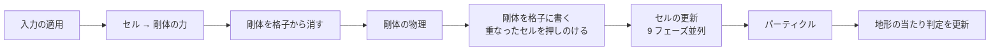
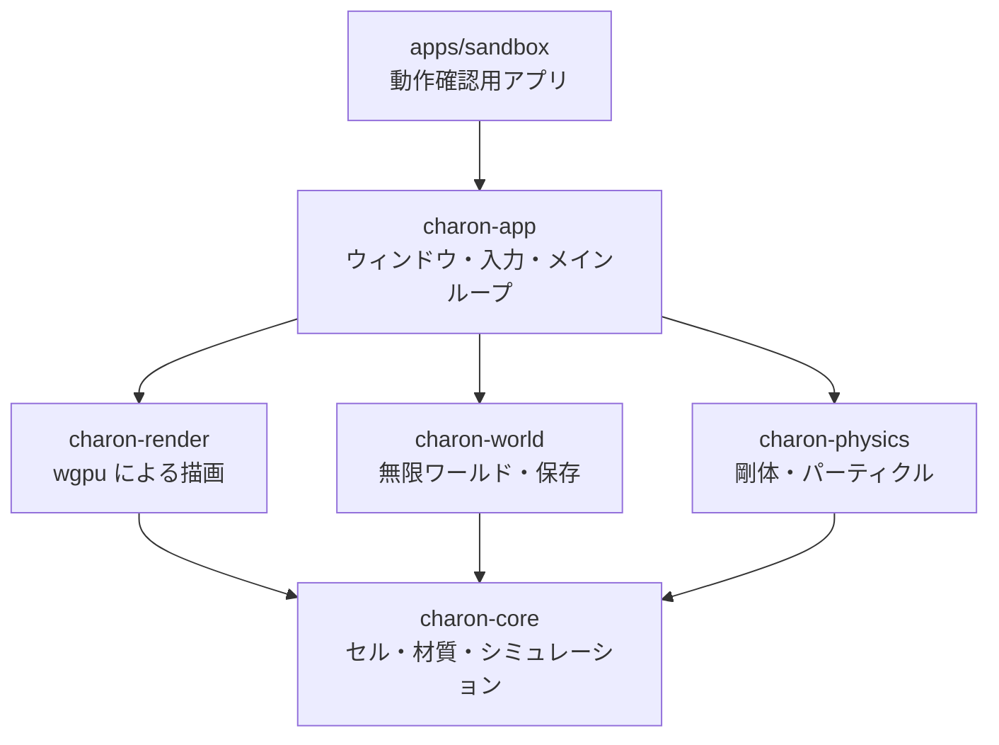
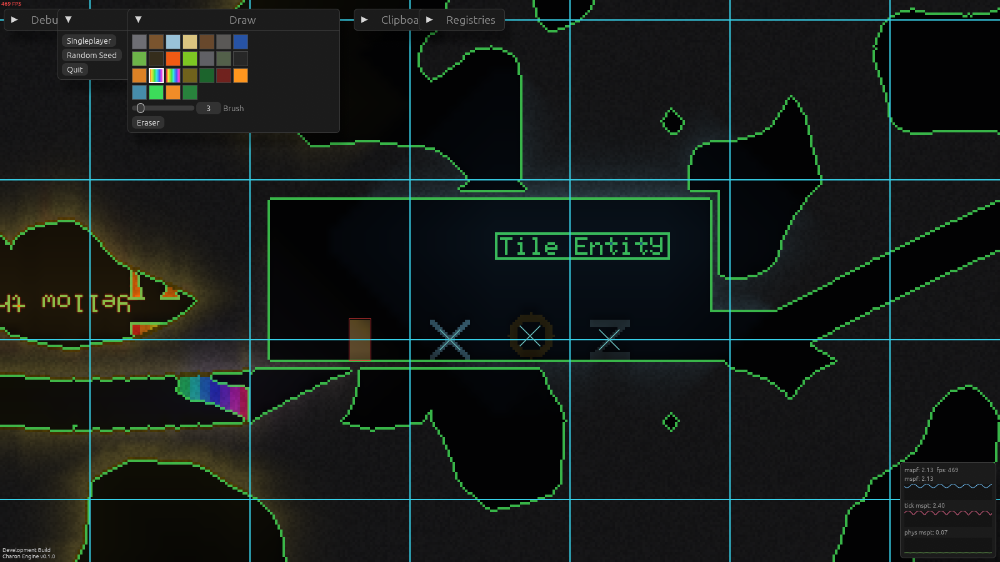
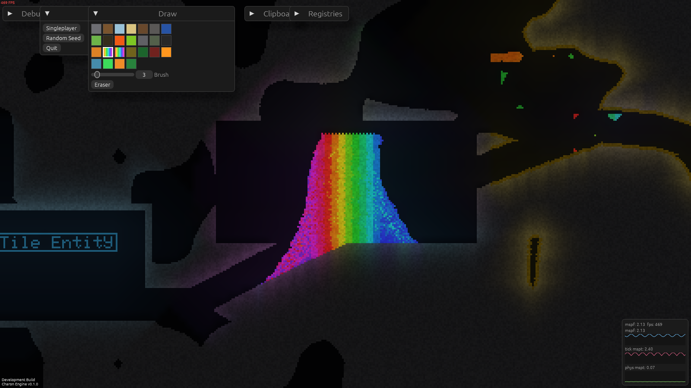
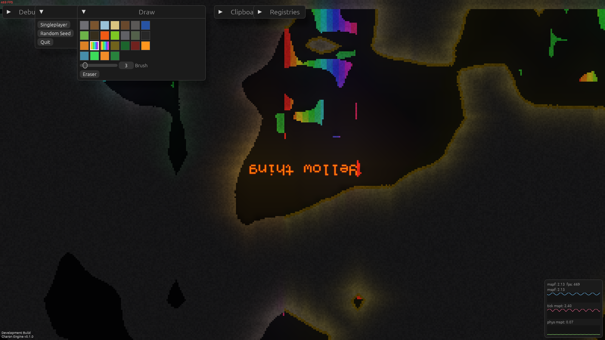
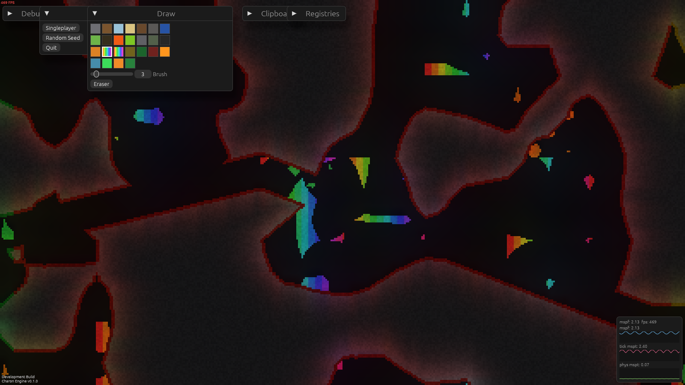

<div align="center">

# Charon Engine

**落下砂 (falling sand) ゲームのための Rust 製 2D エンジン**

砂が崩れ、水が流れ、油が燃え、溶岩が水を蒸気に変える。<br>
[Noita](https://noitagame.com/) や Terraria のような、すべてのピクセルが物理に従う世界を作るための土台です。

[](https://github.com/sofia-gros/charon-engine/actions/workflows/ci.yml)
-orange?logo=rust)


[ロードマップ](docs/ROADMAP.md) ・ [仕様](docs/spec/) ・ [テストの書き方](docs/TESTING.md) ・ [実装者向けの規則](CLAUDE.md)

</div>

---

> [!NOTE]
> **M10 まで実装・自動テスト済みです (M9 は性能の計測、M10 は FallingSandEngine の参照動画に合わせたデモ)。** Windows の RTX 4060 (Vulkan) でオフスクリーン描画を実行し、出力を確認しました。Windows サンドボックスは起動を確認し、画面不要の入力・停止/再開・保存/再読込テストを追加しています。最新の GUI 操作・ウィンドウ撮影は未検証です。Web は wasm ビルドまで確認し、ブラウザー上の保存・操作は後日検証します。Android 実機も未検証です。詳しくは[現在の状態](#現在の状態)と[プラットフォーム確認](docs/PLATFORM_CHECK.md)をご覧ください。
> 100 万セル / 8 ms の性能目標は未達 (84.509 ms) です。試した最適化案は改善が確認できず不採用。実測値は[ベンチマーク記録](docs/BENCHMARKS.md)にあります。
> 参照デモ ([charon-demo](#参照デモを起動)) は RTX 4060 (Vulkan) のオフスクリーン描画で 5 場面を確認しました。ウィンドウでのマウス・キー操作の目視と、Web・Android・Linux での確認は未検証です。

## 目次

- [特徴](#特徴)
- [なぜ作るのか](#なぜ作るのか)
- [しくみ](#しくみ)
- [材質はデータで定義する](#材質はデータで定義する)
- [現在の状態](#現在の状態)
- [開発をはじめる](#開発をはじめる)
- [リポジトリの構成](#リポジトリの構成)
- [文書](#文書)
- [謝辞](#謝辞)
- [ライセンス](#ライセンス)

## 特徴

| | |
|---|---|
| **粉体・液体・気体** | 密度の差で沈み、浮き、混ざる。砂は水に沈み、油は水に浮く |
| **摩擦と粘性** | 材質ごとに崩れやすさ、流れやすさを設定できる。スライムはゆっくり垂れる |
| **反応・熱・燃焼** | 「水 + 溶岩 → 蒸気 + 石」のような反応、熱の伝導、融解と沸騰、燃え広がる火 |
| **剛体との相互作用** | 容器に砂や水をためて運べる。傾ければこぼれる。船は浮き、水を入れたコップは重くなる |
| **決定的なシミュレーション核** | 同じ seed なら並列 feature の有無でセルの結果が一致する。剛体を含む異種 OS 間の同期は未検証 |
| **`unsafe` なしの並列化** | 9 フェーズ更新で、各スレッドにチャンクの所有権を丸ごと渡す |
| **休眠** | 動いていない領域は CPU も GPU も使わない |
| **どこでも動く描画** | wgpu + WGSL。コンピュートシェーダーを使わないので、モバイルや古い GPU でも動く |
| **データ駆動** | 材質と反応は RON ファイル。コードを変えずに追加できる |
| **ヘッドレスな核** | シミュレーションは描画なしで動く。テストやサーバーでそのまま使える |

## なぜ作るのか

出発点は [FallingSandEngine](https://github.com/PieKing1215/FallingSandEngine) の調査です。
チャンク、描画、ワールド生成までよく作り込まれたエンジンですが、開発は止まっています。
ソースを読んで見つかった問題を、設計の最初から避けることにしました。

| FallingSandEngine で見つかった問題 | Charon Engine の設計 |
|---|---|
| 動くのは砂だけ。液体・気体・反応がない | 液体・気体・反応・熱を最初に作る |
| 1 ピクセル約 32 バイト。動かすたびに参照カウントを増減 | 1 セル 8 バイトの `Copy` 型 |
| 並列化が未定義動作に依存 (`unsafe` 116 箇所) | `unsafe` を禁止したまま並列化 |
| 乱数にシードがなく、結果を再現できない | 乱数を seed・座標・tick から導出 |
| 材質がコードに直書き | 材質と反応は RON ファイル |
| OpenGL 4.3 必須。macOS やモバイルで動かない | wgpu。コンピュートシェーダー不要 |
| エンジンとゲームが分離していない | 核は描画に依存しないライブラリ |
| 19,000 行にテスト 7 個 | 各タスクの完了条件がテスト |

## しくみ

### 1 tick の流れ



セルの更新では、1 つのセルについて「寿命 → 熱 → 反応 → 燃焼 → 移動」を順に処理します。

### `unsafe` なしで並列化する

世界は 64×64 セルのチャンクに分かれています。チャンクを 3×3 の 9 色に塗り分け、同じ色のチャンクを
同時に処理します。同じ色のチャンク同士は 3 チャンク離れているので、「自分と周囲 8 チャンク」が
重なりません。そのため、各スレッドに 9 チャンクの所有権を丸ごと渡せます。

```
0 1 2 0 1 2      同じ番号のチャンクを同時に処理する。
3 4 5 3 4 5      たとえば「4」のチャンクは、周囲 8 チャンクを含めても
6 7 8 6 7 8      他の「4」の範囲と重ならない。
0 1 2 0 1 2
```

### 剛体と中身

剛体は毎 tick、セルの格子に形を書き込みます。書き込まれた壁は、砂や水から見ると普通の固体です。
だから「C」の形の容器に入れた砂は壁で止まり、開口部が下を向けば、特別な処理なしに落ちます。

### クレートの構成



`charon-core` は描画・ウィンドウに依存しません。M8 までの機能は各クレートで実装済みで、Web の実ブラウザー確認は保留中です。

## 材質はデータで定義する

材質は [`assets/materials.ron`](assets/materials.ron)、反応は [`assets/reactions.ron`](assets/reactions.ron) に書きます。

```ron
// 砂: 粉体。friction が小さいほどさらさら崩れる
(name: "sand", phase: Powder, density: 1600, color: (218, 196, 128, 255), friction: 30),

// スライム: 粘性の高い液体。ゆっくり垂れる
(name: "slime", phase: Liquid, density: 1100, color: (120, 200, 80, 230),
 dispersion: 1, viscosity: 240),

// 水: 100 度で蒸気に、0 度で氷になる
(name: "water", phase: Liquid, density: 1000, color: (48, 110, 220, 190), dispersion: 5,
 boil: Some((at: 100, into: "steam")), freeze: Some((at: 0, into: "ice"))),
```

```ron
// 水と溶岩が触れると、確率 200/256 で蒸気と石になる
(a: "water", b: "lava", prob: 200, out_a: "steam", out_b: "stone"),
```

現在 15 種類の材質を定義しています: 石、木、氷、砂、土、灰、水、スライム、油、溶岩、酸、蒸気、メタン、煙、火。

## 現在の状態

| | マイルストーン | 状態 |
|---|---|---|
| M0 | 環境整備、仕様、テスト方針 | ✅ 完了 |
| M1 | シミュレーション核: 粉体・液体・気体、摩擦、粘性、休眠 | ✅ 完了 |
| M2 | 反応、熱、相変化、燃焼 | ✅ 完了 |
| M3 | 並列化と性能 (100 万セルの性能目標は未達) | ✅ 検証完了 |
| M4 | 描画とサンドボックス (Windows / Linux / macOS / Android) | ✅ 実装済み。Linux / macOS と Android 実機は未検証 |
| M5 | 無限ワールドと保存 | ✅ 実装済み。Windows で移動・再起動を確認 |
| M6 | 剛体とパーティクル | ✅ 実装済み。Windows の剛体 GUI 操作は未検証 |
| M7 | ライティングと後処理 | ✅ 実装・自動テスト済み。Android 60 fps は未計測 |
| M8 | ゲーム層 (エンティティ、ワールド生成、MOD、入力同期、Web) | ✅ 実装・自動テスト済み。Web の保存・ポインター操作は実ブラウザーで未検証 |
| M9 | Windows のシミュレーション性能の再計測と改善 | ✅ 計測・自動検証、RTX 4060 (Vulkan) のオフスクリーン描画を確認。T9.6 で空セル書き込み時の走査を省き、100 万セルは 84.509 → 約 35〜41 ms/tick に短縮 (8 ms 目標は未達)。休眠 10,000 チャンクは 43.415 µs/tick で達成 |
| M10 | 参照デモ場面 (`charon-demo`)。暗い洞窟・バイオーム・虹色の砂・背景の奥で動き回る虹色の shader・回る十字の剛体・プレイヤー・参照画面の UI | ✅ 実装・自動テスト済み。RTX 4060 のオフスクリーン描画で確認。ウィンドウ操作・Web・Android・Linux は未検証 |
| M11 | Noita 型ゲームの中核。体力・環境ダメージ・飛び道具・爆発ダメージ・杖と呪文・敵・ワイヤーフック | ✅ T11.1〜T11.4、T11.6〜T11.8 (呪文・杖・敵・ワイヤーフックの既定の RON と、ゲーム側の追加・上書き API、敵の AI、物理ワイヤー) を実装・自動テスト済み。`Wand` パネルは RTX 4060 のオフスクリーン描画で確認。ウィンドウ操作は未検証。掘る道具・浮遊 (T11.5) は未着手 |

各マイルストーンのタスクと完了条件は [docs/ROADMAP.md](docs/ROADMAP.md) に、実機確認の結果と未実施項目は [docs/PLATFORM_CHECK.md](docs/PLATFORM_CHECK.md) にあります。T8.8 は Windows 実行ファイルの起動に加えて画面不要の入力・保存・再開テストを確認済みで、GUI 操作・撮影と Web 実機確認は後日実施します。

### 性能の目標

M9 の最終再計測 (Ryzen 7 2700 / Windows 11) は、並列で動く砂 1,048,576 個を **84.509 ms/tick**、休眠 10,000 チャンクを **43.415 µs/tick** でした。更新フェーズ内の粉体移動を調べましたが、試した変更に有意な改善はなく不採用です。デスクトップ 8 ms 目標は未達です。条件と全場面の履歴は [docs/BENCHMARKS.md](docs/BENCHMARKS.md) を参照してください。

| 環境 | 目標 |
|---|---|
| デスクトップ (8 コア) | 動いているセル 100 万個の 1 tick を 8 ms 以内 |
| Android (高性能 4 コア) | 動いているセル 25 万個の 1 tick を 8 ms 以内 |
| 休眠した領域 | コストほぼ 0 |

## 開発をはじめる

### 必要なもの

- [Rust](https://rustup.rs/) の最新 stable (1.99 以上)。`rust-toolchain.toml` が自動で選びます
- Android と WebAssembly 向けのコンパイル確認をする場合は、ターゲットを追加します

```bash
rustup target add aarch64-linux-android wasm32-unknown-unknown
```

- **Linux でウィンドウを開く場合**: システムライブラリ `libxkbcommon-x11` (Debian / Ubuntu では `libxkbcommon-x11-0`) が必要です。
  ない環境では起動直後に `Library libxkbcommon-x11.so could not be loaded.` で panic します
- **GPU のない Linux でウィンドウを開く場合**: X11 のウィンドウに対応するソフトウェア Vulkan として、
  `mesa-vulkan-drivers` (lavapipe) を入れ、`VK_ICD_FILENAMES=/usr/share/vulkan/icd.d/lvp_icd.json` を指定します
  (物理 GPU の検証にはなりません)。Chromium 同梱の SwiftShader はオフスクリーンの描画テストには使えますが、
  ウィンドウには対応しません
- **Web を動かす場合**: `wasm-bindgen-cli` が必要です。`Cargo.lock` の `wasm-bindgen` と**同じ版**を入れます
  (現在は 0.2.130)

### Windows サンドボックスを起動

```bash
cargo run -p charon-sandbox --bin charon-sandbox
```

ワールドの保存先は起動時の作業ディレクトリにある `saves/default` です。最新の Windows GUI での配置・復帰や撮影は未検証です。

### 参照デモを起動

[FallingSandEngine](https://github.com/PieKing1215/FallingSandEngine) の参照動画に合わせたデモです。暗い洞窟を、光る材質だけが照らします。黄・緑・赤のバイオームがあり、虹色の砂を注いで山にできます。スタート地点の部屋には X 字・輪・Z 字の剛体と `Tile Entity` の看板があります。デスクトップ専用です。

```bash
cargo run -p charon-sandbox --bin charon-demo
```

| 操作 | |
|---|---|
| `A` / `D` / `←` / `→` | 左右に歩く |
| `W` / `↑` / `Space` / `C` | ジャンプ |
| `F` | 自由カメラ (`WASD` で移動、`Shift` で速く) |
| マウスの左ボタン (**左手 = 武器**) | カーソルの方向へ杖を撃つ。剛体の上ならつかんで動かせる |
| マウスの右ボタン (**右手 = 道具**) | ワイヤーフック: カーソルの方向へワイヤーを撃ち、着弾したら引っ張る。押している間は巻き取り、離すと外れる |
| `B` (または `Draw` の `Paint`) | 左ボタンを、選んだ材質を置くブラシ (既定は虹色の砂) に切り替える。もう一度で武器に戻る |
| `Ctrl` + ドラッグ → `Clipboard` の `Copy` / `Paste` | 矩形のコピーと貼り付け |
| `Main Menu` | `Singleplayer` (seed 1 に戻る)、`Random Seed` (新しい seed)、`Quit` |

「同じ」の範囲と、再現しないもの (CPU・メモリのグラフ、参照の絵素材、`Z` / `X` キーなど) は[仕様 09](docs/spec/09-demo-scene.md)にあります。実 GPU の画像:

| | |
|---|---|
|  |  |
|  |  |

### Web サンドボックスを起動

ブラウザーで動くサンドボックスです。WebGPU が使えるブラウザーでは WebGPU、使えなければ WebGL2 で描きます
(アダプターを取得できない場合を含みます)。

```bash
cargo install wasm-bindgen-cli --version 0.2.130 --locked
```

```bash
scripts/build-web.sh
```

```bash
python3 -m http.server 8766 --directory apps/sandbox/web
```

`http://127.0.0.1:8766/` を開きます。ワールドはブラウザーの `localStorage` (`charon.world.v1`) に、Sandbox パネルの
`Save world` で保存されます。

実ブラウザーでの起動・描画ループ・キャンバスの大きさを自動で確かめるスモークテストがあります
(Playwright と Chromium が必要。リポジトリの依存ではありません)。WebGPU のキャンバスへの描画は、
ヘッドレスの Chromium ではデバイスが破棄されるため、このテストの対象外です。

```bash
node tools/web-smoke/smoke.js
```

### 確認

コミットの前に実行します。CI も同じスクリプトを実行します。

```bash
scripts/check.sh
```

fmt、clippy、テスト、ドキュメントのビルド、Android と WebAssembly 向けのコンパイル確認を順に行います。

### 個別のコマンド

```bash
cargo test --workspace
```

```bash
cargo clippy --workspace --all-targets -- -D warnings
```

```bash
cargo fmt --all
```

### 移動規則の試作を動かす

液体と粉体の規則は、Python の試作で「必ず止まる」「水面が平らになる」ことを確かめてあります。

```bash
python3 tools/prototype/run.py
```

## リポジトリの構成

```
charon-engine/
├── crates/
│   ├── charon-core/        シミュレーション核
│   ├── charon-world/       チャンク生成・保存・背景
│   ├── charon-physics/     剛体・パーティクル
│   ├── charon-render/      wgpu 描画
│   ├── charon-app/         入力・ウィンドウ・メインループ
│   └── charon-game/        エンティティ・入力同期
├── apps/sandbox/           Windows / Android / Web の動作確認用アプリ
├── assets/                 材質と反応の定義
├── docs/
│   ├── ROADMAP.md          マイルストーンとタスク
│   ├── PLATFORM_CHECK.md   実機確認と未実施項目
│   ├── TESTING.md          テストの書き方
│   └── spec/               実装の仕様 (01〜07)
├── tools/prototype/        移動規則の Python 試作
├── scripts/                チェックと Web ビルド
└── CLAUDE.md               実装者向けの規則
```

## 文書

| 文書 | 内容 |
|---|---|
| [ROADMAP](docs/ROADMAP.md) | 設計原則、マイルストーン、タスクと完了条件 |
| [TESTING](docs/TESTING.md) | テストの置き場所、`testkit`、決定性の確認 |
| [CLAUDE.md](CLAUDE.md) | 実装の進め方と守ること |
| [仕様 01: 核となるデータ](docs/spec/01-core-data.md) | 座標、セル、材質、乱数、チャンク |
| [仕様 02: シミュレーション](docs/spec/02-simulation.md) | 粉体・液体・気体の移動、休眠、並列化 |
| [仕様 03: 反応と熱](docs/spec/03-reactions-heat.md) | 反応、熱、相変化、燃焼、寿命 |
| [仕様 04: ワールドと保存](docs/spec/04-world-save.md) | チャンクの読み込み、保存形式、生成 |
| [仕様 05: 剛体](docs/spec/05-rigid-bodies.md) | 剛体とセルの相互作用、浮力、パーティクル |
| [仕様 06: 描画とプラットフォーム](docs/spec/06-rendering-platform.md) | wgpu、シェーダー、Android、メインループ |
| [仕様 07: ゲーム層](docs/spec/07-game-layer.md) | エンティティ、MOD、入力同期、Web |
| [仕様 08: 性能](docs/spec/08-performance.md) | デスクトップの計測条件、改善と決定性の検証 |
| [プラットフォーム確認](docs/PLATFORM_CHECK.md) | 実機で確認したことと、後日検証する項目 |

## 謝辞

- [FallingSandEngine](https://github.com/PieKing1215/FallingSandEngine) (PieKing1215): 設計の出発点。
  剛体を格子に書き込む方式など、多くを学びました
- [Noita](https://noitagame.com/) (Nolla Games): 目指している体験

## ライセンス

未定です。決まるまで、このリポジトリのコードを再利用する権利は与えられていません。
