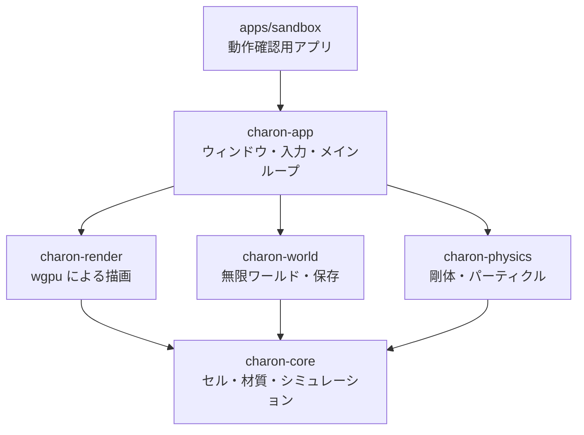

<div align="center">

# Charon Engine

**落下砂 (falling sand) ゲームのための Rust 製 2D エンジン**

砂が崩れ、水が流れ、油が燃え、溶岩が水を蒸気に変える。<br>
[Noita](https://noitagame.com/) や Terraria のような、すべてのピクセルが物理に従う世界を作るための土台です。

[](https://github.com/sofia-gros/charon-engine/actions/workflows/ci.yml)
-orange?logo=rust)


[ロードマップ](docs/ROADMAP.md) ・ [仕様](docs/spec/) ・ [テストの書き方](docs/TESTING.md) ・ [実装者向けの規則](CLAUDE.md)

</div>

---

> [!NOTE]
> **現在は設計と環境整備が終わった段階です。** エンジンの機能はまだ実装されていません。
> このページの「特徴」は、仕様として確定している設計目標です。進み具合は[現在の状態](#現在の状態)を見てください。

## 目次

- [特徴](#特徴)
- [なぜ作るのか](#なぜ作るのか)
- [しくみ](#しくみ)
- [材質はデータで定義する](#材質はデータで定義する)
- [現在の状態](#現在の状態)
- [開発をはじめる](#開発をはじめる)
- [リポジトリの構成](#リポジトリの構成)
- [文書](#文書)
- [謝辞](#謝辞)
- [ライセンス](#ライセンス)

## 特徴

| | |
|---|---|
| **粉体・液体・気体** | 密度の差で沈み、浮き、混ざる。砂は水に沈み、油は水に浮く |
| **摩擦と粘性** | 材質ごとに崩れやすさ、流れやすさを設定できる。スライムはゆっくり垂れる |
| **反応・熱・燃焼** | 「水 + 溶岩 → 蒸気 + 石」のような反応、熱の伝導、融解と沸騰、燃え広がる火 |
| **剛体との相互作用** | 容器に砂や水をためて運べる。傾ければこぼれる。船は浮き、水を入れたコップは重くなる |
| **決定的** | 同じ seed なら、OS やスレッド数が違っても同じ結果になる。リプレイとマルチプレイの土台 |
| **`unsafe` なしの並列化** | 9 フェーズ更新で、各スレッドにチャンクの所有権を丸ごと渡す |
| **休眠** | 動いていない領域は CPU も GPU も使わない |
| **どこでも動く描画** | wgpu + WGSL。コンピュートシェーダーを使わないので、モバイルや古い GPU でも動く |
| **データ駆動** | 材質と反応は RON ファイル。コードを変えずに追加できる |
| **ヘッドレスな核** | シミュレーションは描画なしで動く。テストやサーバーでそのまま使える |

## なぜ作るのか

出発点は [FallingSandEngine](https://github.com/PieKing1215/FallingSandEngine) の調査です。
チャンク、描画、ワールド生成までよく作り込まれたエンジンですが、開発は止まっています。
ソースを読んで見つかった問題を、設計の最初から避けることにしました。

| FallingSandEngine で見つかった問題 | Charon Engine の設計 |
|---|---|
| 動くのは砂だけ。液体・気体・反応がない | 液体・気体・反応・熱を最初に作る |
| 1 ピクセル約 32 バイト。動かすたびに参照カウントを増減 | 1 セル 8 バイトの `Copy` 型 |
| 並列化が未定義動作に依存 (`unsafe` 116 箇所) | `unsafe` を禁止したまま並列化 |
| 乱数にシードがなく、結果を再現できない | 乱数を seed・座標・tick から導出 |
| 材質がコードに直書き | 材質と反応は RON ファイル |
| OpenGL 4.3 必須。macOS やモバイルで動かない | wgpu。コンピュートシェーダー不要 |
| エンジンとゲームが分離していない | 核は描画に依存しないライブラリ |
| 19,000 行にテスト 7 個 | 各タスクの完了条件がテスト |

## しくみ

### 1 tick の流れ


セルの更新では、1 つのセルについて「寿命 → 熱 → 反応 → 燃焼 → 移動」を順に処理します。

### `unsafe` なしで並列化する

世界は 64×64 セルのチャンクに分かれています。チャンクを 3×3 の 9 色に塗り分け、同じ色のチャンクを
同時に処理します。同じ色のチャンク同士は 3 チャンク離れているので、「自分と周囲 8 チャンク」が
重なりません。そのため、各スレッドに 9 チャンクの所有権を丸ごと渡せます。

```
0 1 2 0 1 2      同じ番号のチャンクを同時に処理する。
3 4 5 3 4 5      たとえば「4」のチャンクは、周囲 8 チャンクを含めても
6 7 8 6 7 8      他の「4」の範囲と重ならない。
0 1 2 0 1 2
```

### 剛体と中身

剛体は毎 tick、セルの格子に形を書き込みます。書き込まれた壁は、砂や水から見ると普通の固体です。
だから「C」の形の容器に入れた砂は壁で止まり、開口部が下を向けば、特別な処理なしに落ちます。

### クレートの構成 (予定)



`charon-core` は他のどれにも依存しません。現在あるのは `charon-core` の雛形だけです。

## 材質はデータで定義する

材質は [`assets/materials.ron`](assets/materials.ron)、反応は [`assets/reactions.ron`](assets/reactions.ron) に書きます。

```ron
// 砂: 粉体。friction が小さいほどさらさら崩れる
(name: "sand", phase: Powder, density: 1600, color: (218, 196, 128, 255), friction: 30),

// スライム: 粘性の高い液体。ゆっくり垂れる
(name: "slime", phase: Liquid, density: 1100, color: (120, 200, 80, 230),
 dispersion: 1, viscosity: 240),

// 水: 100 度で蒸気に、0 度で氷になる
(name: "water", phase: Liquid, density: 1000, color: (48, 110, 220, 190), dispersion: 5,
 boil: Some((at: 100, into: "steam")), freeze: Some((at: 0, into: "ice"))),
```

```ron
// 水と溶岩が触れると、確率 200/256 で蒸気と石になる
(a: "water", b: "lava", prob: 200, out_a: "steam", out_b: "stone"),
```

現在 15 種類の材質を定義しています: 石、木、氷、砂、土、灰、水、スライム、油、溶岩、酸、蒸気、メタン、煙、火。

## 現在の状態

| | マイルストーン | 状態 |
|---|---|---|
| M0 | 環境整備、仕様、テスト方針 | ✅ 完了 |
| M1 | シミュレーション核: 粉体・液体・気体、摩擦、粘性、休眠 | ⏳ 次に着手 |
| M2 | 反応、熱、相変化、燃焼 | ・ |
| M3 | 並列化と性能 | ・ |
| M4 | 描画とサンドボックス (Windows / Linux / macOS / Android) | ・ |
| M5 | 無限ワールドと保存 | ・ |
| M6 | 剛体とパーティクル | ・ |
| M7 | ライティングと後処理 | ・ |
| M8 | ゲーム層 (エンティティ、ワールド生成、MOD、マルチプレイ、Web) | ・ |

各マイルストーンのタスクと完了条件は [docs/ROADMAP.md](docs/ROADMAP.md) にあります。

### 性能の目標

実測はまだありません。M3 のベンチマークで検証します。

| 環境 | 目標 |
|---|---|
| デスクトップ (8 コア) | 動いているセル 100 万個の 1 tick を 8 ms 以内 |
| Android (高性能 4 コア) | 動いているセル 25 万個の 1 tick を 8 ms 以内 |
| 休眠した領域 | コストほぼ 0 |

## 開発をはじめる

### 必要なもの

- [Rust](https://rustup.rs/) の最新 stable (1.99 以上)。`rust-toolchain.toml` が自動で選びます
- Android と WebAssembly 向けのコンパイル確認をする場合は、ターゲットを追加します

```bash
rustup target add aarch64-linux-android wasm32-unknown-unknown
```

### 確認

コミットの前に実行します。CI も同じスクリプトを実行します。

```bash
scripts/check.sh
```

fmt、clippy、テスト、ドキュメントのビルド、Android と WebAssembly 向けのコンパイル確認を順に行います。

### 個別のコマンド

```bash
cargo test --workspace
```

```bash
cargo clippy --workspace --all-targets -- -D warnings
```

```bash
cargo fmt --all
```

### 移動規則の試作を動かす

液体と粉体の規則は、Python の試作で「必ず止まる」「水面が平らになる」ことを確かめてあります。

```bash
python3 tools/prototype/run.py
```

## リポジトリの構成

```
charon-engine/
├── crates/
│   └── charon-core/        シミュレーション核 (描画に依存しない)
├── assets/
│   ├── materials.ron       材質の定義
│   └── reactions.ron       反応の定義
├── docs/
│   ├── ROADMAP.md          マイルストーンとタスク
│   ├── TESTING.md          テストの書き方
│   └── spec/               実装の仕様 (01〜06)
├── tools/prototype/        移動規則の Python 試作
├── scripts/check.sh        コミット前の確認
└── CLAUDE.md               実装者向けの規則
```

## 文書

| 文書 | 内容 |
|---|---|
| [ROADMAP](docs/ROADMAP.md) | 設計原則、マイルストーン、タスクと完了条件 |
| [TESTING](docs/TESTING.md) | テストの置き場所、`testkit`、決定性の確認 |
| [CLAUDE.md](CLAUDE.md) | 実装の進め方と守ること |
| [仕様 01: 核となるデータ](docs/spec/01-core-data.md) | 座標、セル、材質、乱数、チャンク |
| [仕様 02: シミュレーション](docs/spec/02-simulation.md) | 粉体・液体・気体の移動、休眠、並列化 |
| [仕様 03: 反応と熱](docs/spec/03-reactions-heat.md) | 反応、熱、相変化、燃焼、寿命 |
| [仕様 04: ワールドと保存](docs/spec/04-world-save.md) | チャンクの読み込み、保存形式、生成 |
| [仕様 05: 剛体](docs/spec/05-rigid-bodies.md) | 剛体とセルの相互作用、浮力、パーティクル |
| [仕様 06: 描画とプラットフォーム](docs/spec/06-rendering-platform.md) | wgpu、シェーダー、Android、メインループ |

## 謝辞

- [FallingSandEngine](https://github.com/PieKing1215/FallingSandEngine) (PieKing1215): 設計の出発点。
  剛体を格子に書き込む方式など、多くを学びました
- [Noita](https://noitagame.com/) (Nolla Games): 目指している体験

## ライセンス

未定です。決まるまで、このリポジトリのコードを再利用する権利は与えられていません。
