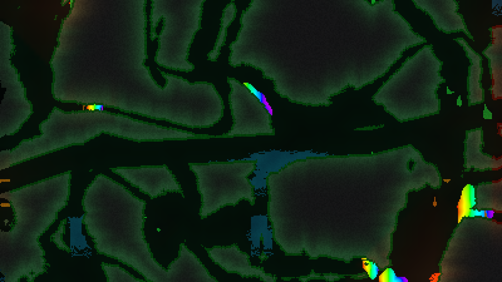
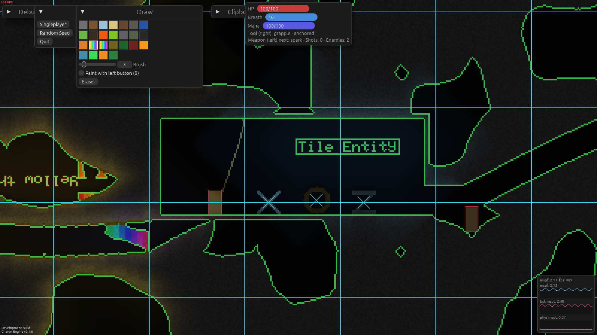
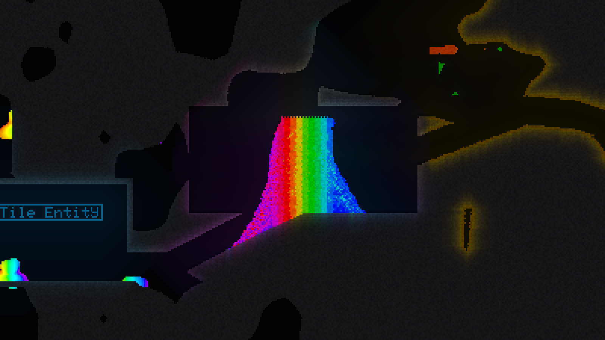
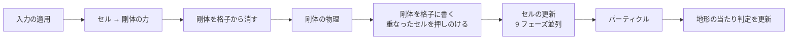
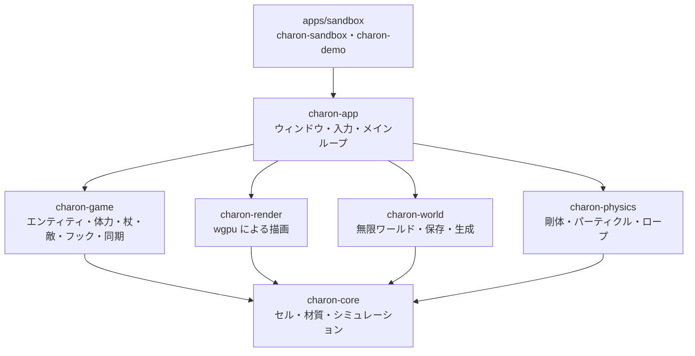

<div align="center">

# Charon Engine

**落下砂 (falling sand) ゲームのための Rust 製 2D エンジン**

砂が崩れ、水が流れ、油が燃え、溶岩が水を蒸気に変える。<br>
[Noita](https://noitagame.com/) や Terraria のような、すべてのピクセルが物理に従う世界を作るための土台です。

[](https://github.com/sofia-gros/charon-engine/actions/workflows/ci.yml)

-orange?logo=rust)


[ロードマップ](docs/ROADMAP.md) ・ [実装の状況](docs/STATUS.md) ・ [仕様](docs/spec/) ・ [ゲーム API](docs/GAME_API.md) ・ [テストの書き方](docs/TESTING.md) ・ [実装者向けの規則](CLAUDE.md)

</div>

---

> [!NOTE]
> **M12 まで実装・自動テスト済みです。** Windows (Ryzen 7 2700 / RTX 4060) で起動と実描画を確認し、速度は十分でした。
> 100 万セル / 8 ms の性能目標は未達 (約 35〜41 ms) です。ウィンドウでの最新の操作確認、macOS、Android 実機、Web の保存・操作は未検証です。
> 詳しくは[実装の状況](docs/STATUS.md)と[プラットフォーム確認](docs/PLATFORM_CHECK.md)をご覧ください。

| | |
|---|---|
|  |  |
|  |  |

## 特徴

| | |
|---|---|
| **粉体・液体・気体** | 密度の差で沈み、浮き、混ざる。砂は水に沈み、油は水に浮く。摩擦と粘性は材質ごとに設定できる |
| **反応・熱・燃焼** | 「水 + 溶岩 → 蒸気 + 石」のような反応、熱の伝導、融解と沸騰、燃え広がる火 |
| **剛体との相互作用** | 容器に砂や水をためて運べる。傾ければこぼれる。船は浮く。剛体はドットでも滑らかにも描ける |
| **ゲーム層** | プレイヤー (楕円の当たり判定、砂を押し出す)、体力、飛び道具、杖と呪文、敵、ワイヤーフック |
| **データ駆動** | 材質・反応・呪文・杖・敵・フックは RON。エンジンが既定を持ち、ゲーム (MOD) が追加・上書きできる |
| **決定的なシミュレーション核** | 同じ seed なら並列 feature の有無でセルの結果が一致する。乱数は seed・座標・tick から導く |
| **`unsafe` なしの並列化** | 9 フェーズ更新で、各スレッドにチャンクの所有権を丸ごと渡す |
| **休眠と更新範囲** | 動いていない領域は何もしない。カメラから遠いチャンクは更新しない (Terraria と同じ) |
| **どこでも動く描画** | wgpu + WGSL、コンピュートシェーダーなし。光は Off / Low / High / xHigh から選べる |
| **音** | 依存なしのミキサー (パン・音量・ピッチ・ループ)、効果音の生成、WAV の読み込み。`cpal` で音声デバイスへ出力 (聞こえるかは未確認、BGM・空間音は未実装) |
| **問い合わせ・出来事・演出** | raycast・視線・円の検索、`GameEvent` (当たった・倒した・掘った)、カメラのなめらかな追従と揺れ、掘ったあとの地形の崩落 |
| **通信 (エンジンの層)** | Lockstep の上のホスト中継 TCP (標準ライブラリだけ)。接続情報の照合、他人のふり・壊れたメッセージの拒否、2 つの世界が毎 tick 同じハッシュになることをテスト。アプリへの組み込みは未実装 |
| **ヘッドレスな核** | シミュレーションは描画なしで動く。テストやサーバーでそのまま使える |

## なぜ作るのか

出発点は [FallingSandEngine](https://github.com/PieKing1215/FallingSandEngine) の調査です。
チャンク、描画、ワールド生成までよく作り込まれたエンジンですが、開発は止まっています。
ソースを読んで見つかった問題を、設計の最初から避けることにしました。

| FallingSandEngine で見つかった問題 | Charon Engine の設計 |
|---|---|
| 動くのは砂だけ。液体・気体・反応がない | 液体・気体・反応・熱を最初に作る |
| 1 ピクセル約 32 バイト。動かすたびに参照カウントを増減 | 1 セル 8 バイトの `Copy` 型 |
| 並列化が未定義動作に依存 (`unsafe` 116 箇所) | `unsafe` を禁止したまま並列化 |
| 乱数にシードがなく、結果を再現できない | 乱数を seed・座標・tick から導出 |
| 材質がコードに直書き | 材質と反応は RON ファイル |
| OpenGL 4.3 必須。macOS やモバイルで動かない | wgpu。コンピュートシェーダー不要 |
| エンジンとゲームが分離していない | 核は描画に依存しないライブラリ |
| 19,000 行にテスト 7 個 | 各タスクの完了条件がテスト |

## しくみ



- **`unsafe` なしの並列化:** 世界は 64×64 セルのチャンクで、3×3 の 9 色に塗り分けます。同じ色のチャンクは 3 チャンク離れているので、「自分と周囲 8 チャンク」が重ならず、各スレッドに所有権を丸ごと渡せます。
- **剛体と中身:** 剛体は毎 tick、セルの格子に形を書き込みます。書き込まれた壁は、砂や水から見ると普通の固体なので、容器に入れた砂は壁で止まります。



`charon-core` は描画・ウィンドウに依存しません。

## 材質はデータで定義する

材質は [`assets/materials.ron`](assets/materials.ron)、反応は [`assets/reactions.ron`](assets/reactions.ron) に書きます。呪文・杖・敵・フックも同じ形で、`assets/*.ron` がエンジンの既定、MOD の RON が追加と上書きです ([ゲーム API](docs/GAME_API.md))。

```ron
// 砂: 粉体。friction が小さいほどさらさら崩れる
(name: "sand", phase: Powder, density: 1600, color: (218, 196, 128, 255), friction: 30),

// 水: 100 度で蒸気に、0 度で氷になる
(name: "water", phase: Liquid, density: 1000, color: (48, 110, 220, 190), dispersion: 5,
 boil: Some((at: 100, into: "steam")), freeze: Some((at: 0, into: "ice"))),

// 水と溶岩が触れると、確率 200/256 で蒸気と石になる
(a: "water", b: "lava", prob: 200, out_a: "steam", out_b: "stone"),
```

## 開発をはじめる

[Rust](https://rustup.rs/) の最新 stable (1.99 以上) が必要です (`rust-toolchain.toml` が自動で選びます)。Linux・Web・Android の補足は[実装の状況](docs/STATUS.md#開発環境の補足)にあります。

```bash
cargo run -p charon-sandbox --bin charon-demo
```

参照デモです。暗い洞窟を、光る材質だけが照らします。黄・緑・赤のバイオーム、虹色の砂、背景の奥で動く虹色の shader、スタート地点の部屋の剛体があります。デスクトップ専用で、仕様は[仕様 09](docs/spec/09-demo-scene.md)・[仕様 10](docs/spec/10-noita-like-game.md) です。

| 操作 | |
|---|---|
| `A` / `D` / `←` / `→` | 左右に歩く |
| `W` / `↑` / `Space` / `C` | ジャンプ |
| マウスの左ボタン (左手 = 武器) | カーソルの方向へ杖を撃つ。剛体の上ならつかんで動かせる |
| マウスの右ボタン (右手 = 道具) | ワイヤーフック: 撃って、着弾したら引っ張る。押している間は巻き取り、離すと外れる |
| マウスの中ボタン / `E` (**掘る道具**) | レーザーでカーソルの方向の円を削る。材質ごとの**硬さ**と道具の**力**で、掘る時間が変わる (石は 100 tick、砂は 4 tick) |
| `B` | 左ボタンを、選んだ材質を置くブラシ (既定は虹色の砂) に切り替える |
| `F` | 自由カメラ (`WASD` で移動、`Shift` で速く) |
| `Esc` (ポーズのメニュー) | 再開・UI の大きさ・キャラクターの大きさ・光 (`Off`〜`xHigh`)・**キー割り当ての変更**・持ち物・終了。設定は `settings.ron` に保存 |
| `I` | 持ち物 (掘った材質) |
| `Debug` パネルの `Light` | `Off` / `Low` / `High` / `xHigh` |
| `Ctrl` + ドラッグ → `Clipboard` | 矩形のコピーと貼り付け |
| **タッチ** (Android・タッチ画面) | 左下の仮想スティックで歩く (**上へスワイプ**でジャンプ)、右下のスティックで狙って撃つ、`HOOK`・`DIG`・`JUMP`・`PAINT` ボタン。2 本指でカメラ、1 本指でブラシ |
| **ゲームパッド** (Windows・Linux・macOS・Android) | `A` ジャンプ、`X`・`R1`・`R2` 武器、`B`・`L1` ワイヤーフック、`L2` 掘る、`Y` 武器 / ブラシ、十字キー・左スティックで移動、右スティックで狙う (アナログスティックはデスクトップのみ) |

### ダウンロード

[Releases](https://github.com/sofia-gros/charon-engine/releases) に、タグ (`v*`) ごとの **Windows 版** (zip を展開して `charon-demo.exe`) と **Android 版** (apk、arm64) があります。ビルドは `.github/workflows/release.yml` です ([Android の手順](docs/BUILD_ANDROID.md))。

```bash
cargo run -p charon-sandbox --bin charon-sandbox
```

シンプルなサンドボックスです。Web 版は `scripts/build-web.sh` でビルドします。

### 確認

コミットの前に実行します。CI も同じスクリプトを実行します (fmt、clippy、テスト、ドキュメント、Android・WebAssembly のコンパイル確認)。

```bash
scripts/check.sh
```

## リポジトリの構成

```
charon-engine/
├── crates/
│   ├── charon-core/        シミュレーション核
│   ├── charon-world/       チャンク生成・保存・背景・洞窟
│   ├── charon-physics/     剛体・パーティクル・ロープ
│   ├── charon-render/      wgpu 描画 (光・滑らかな剛体・奥の背景)
│   ├── charon-app/         入力・ウィンドウ・メインループ・デモ
│   ├── charon-game/        エンティティ・体力・杖・敵・フック・掘る・持ち物・入力同期
│   └── charon-audio/       音のミキサー・効果音・WAV
├── apps/sandbox/           charon-sandbox・charon-demo (Windows / Android / Web)
├── assets/                 材質・反応・呪文・杖・敵・フックの定義、デモの MOD
├── docs/                   ロードマップ・仕様・状況・ベンチマーク
├── tools/                  移動規則の Python 試作、Web のスモークテスト
├── scripts/                チェックと Web ビルド
└── CLAUDE.md               実装者向けの規則
```

## 文書

| 文書 | 内容 |
|---|---|
| [ROADMAP](docs/ROADMAP.md) | 設計原則、マイルストーン、タスクと完了条件 |
| [STATUS](docs/STATUS.md) | マイルストーンごとの状況、確認の範囲、性能の目標と実測 |
| [ENGINE_CHECKLIST](docs/ENGINE_CHECKLIST.md) | ゲームエンジンとして必要なことの一覧と、現状・足りないもの |
| [GAME_API](docs/GAME_API.md) | ゲームがエンジンを呼ぶ API (定義の追加・上書き、敵、道具) |
| [TESTING](docs/TESTING.md) | テストの置き場所、`testkit`、決定性の確認 |
| [BENCHMARKS](docs/BENCHMARKS.md) | 性能の実測の履歴 |
| [PLATFORM_CHECK](docs/PLATFORM_CHECK.md) | 実機で確認したことと、後日検証する項目 |
| [仕様 01〜10](docs/spec/) | データ、シミュレーション、反応、ワールド、剛体、描画、ゲーム層、性能、デモ、Noita 型ゲーム |

## 謝辞

- [FallingSandEngine](https://github.com/PieKing1215/FallingSandEngine) (PieKing1215): 設計の出発点。剛体を格子に書き込む方式など、多くを学びました
- [Noita](https://noitagame.com/) (Nolla Games): 目指している体験

## ライセンス

[MIT](LICENSE)
