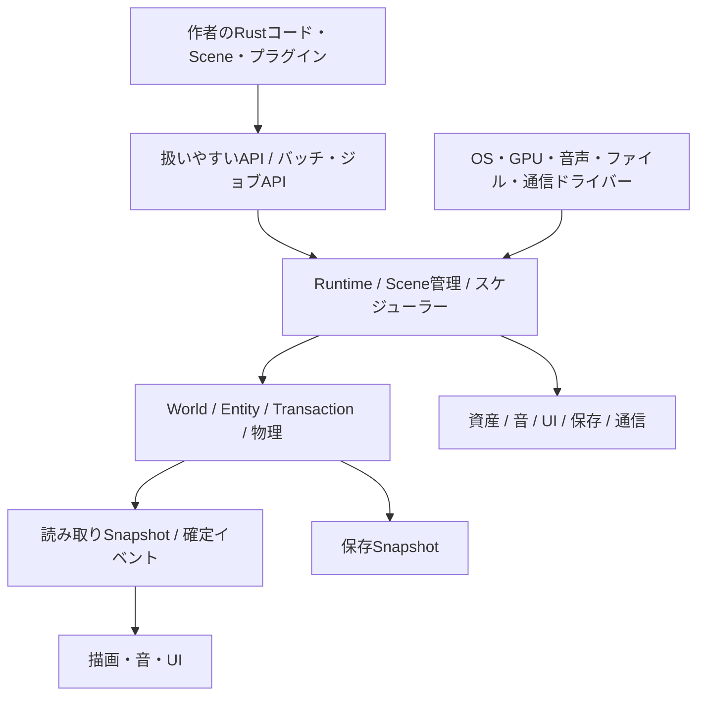

# 全体構造と実行の契約

## 層と所有権

高水準APIはサービスの呼び出しを組み合わせる。下位サービスはSceneの存在を前提にしない。headlessの世界更新、バッチ生成、保存検証、サーバーから同じWorldを動かせる。描画や音がWorldへ逆依存して正規状態を書き換えない。

最初は論理モジュール境界を作り、安定した境界から`charon-core`、`charon-world`、`charon-physics`、`charon-render`、`charon-audio`、`charon-ui`、`charon-net`、`charon-tools`、公開用`charon-engine`、derive用`charon-macros`へ分ける。分割の都合で公開APIや保存形式を各依存の内部型へ結び付けない。

| 所有者 | 所有するもの | 外へ渡すもの |
| --- | --- | --- |
| Engine | サービス、登録済みScene、スケジューラー、設定、プラグイン | Context、サービスの検証済み設定、診断 |
| World | 地形、個体、物理、コンポーネント、正規ジョブ、正規時計 | 読み取りView、操作Facade、ID、Snapshot |
| Scene | 作者の画面状態、購読の範囲、入力の送り先 | 更新要求、表示要求、イベント応答 |
| AssetService | インポート済み資産、参照と保持、GPUへの世代 | 型付きハンドル、読み取り資産 |
| Storage/Network worker | 不変の送受信データ | 検証前の完了通知と候補データ |

## 起動順

1. 起動引数、設定の所在、既定値を読み、明示された上書きを統合する。
2. ビルド内のサービスとプラグインを依存順に登録する。循環、重複、必要機能の欠落を診断する。
3. CPU/GPU/音声/通信の能力を確認し、要求と代替方針を解決する。無効な構成では世界を作らない。
4. コンポーネント型、イベント型、挙動型、保存codec、資産の読み込み処理を登録する。
5. 共通資産を読み、素材・効果・item・recipe・生成定義の参照を解決する。安定キーでcontent manifestを作る。
6. Worldの容量を予約し、生成または候補セーブを復元する。すべて成功してからWorldを公開する。
7. 開始Sceneの資産を読み、Sceneを開始する。以降はイベントループと固定更新を進める。

## 時間と更新

世界の時間は`Tick(u64)`。既定は60 tick/sとし、起動時の共通既定値をWorld作成APIで上書きできる。稼働中の変更はWorld設定変更として記録し、接触solverとtimerの再解釈を含む明示操作に限定する。

Sceneの`update`は世界のtickに対応するゲーム更新、`render`は表示フレームごとの処理とする。`FrameContext`は物理を書き換えられず、入力や表示の都合によって同じtickが二度ゲーム処理されない。UI入力は次のゲームtickへ明示して渡す。

| 順序 | 処理 | commitの意味 |
| --- | --- | --- |
| X0 | 入力、通信、準備済みchunk、外部ジョブの結果を確定 | 未準備の必須領域があれば対象Worldを待機させる |
| X1 | Scene更新、作者システム、AIと装置の意図作成 | WorldViewを読み、順序付き操作を提出する |
| X2 | 配置・採掘・inventory・攻撃・効果の取引 | 各取引を検証・予約後に一括commitする |
| X3 | 動く物体・controller・高速投射物の候補更新 | 剛体候補と流体排除を予約し、物理substepを実行する |
| X4 | 地形支持、破砕、セル・液体・気体の移動 | トークンとsidecarを同時に移し、二重移動を防ぐ |
| X5 | 熱、相変化、反応、燃料・濡れ、正規粒子の着地 | 保存する反応状態と変換を取引としてcommitする |
| X6 | 接触後の補正、ダメージ、死亡、drop、装置・AIの進捗確定 | 標準Deferredの追加連鎖は次tickへ送り、SameTickは候補内で完了を待つ |
| X7 | イベント公開、World tick増分、Snapshot公開 | この境界だけが保存点になる |

上表は標準ScheduleProfileである。通常のイベント応答は次tickの操作へ変換する。同tick内の連鎖や追加更新が必要な場合は、[25のSameTick queueとcommit barrier](25_OPEN_EXTENSION_AND_COLLISION_CONTRACTS.md)を選ぶ。再帰的callbackを使わず、候補tick内の処理を完了してからSnapshotを公開する。音や表示粒子は確定イベントから生成する。

## 操作順とトランザクション

操作は`target_tick, source_id, sequence`で並べる。同じsource内でsequenceが重複したら拒否する。コマンド成功はreceiptで通知し、提出成功とは区別する。取引内では、必要な世界領域・item・粒子・イベント容量をすべて予約し、検証後にcommitする。

複数の独立した操作の一つが失敗しても他の成功を巻き戻さない。複数操作をすべて成功させたい場合は`TransactionBuilder`へまとめる。途中成功した取引は公開しない。

大規模な構造物解析、生成、経路探索などは件数予算を持つ`CanonicalJob`へ分ける。予算到達は保存可能な継続状態を残し、壁時計の経過を理由に途中結果を確定しない。容量不足と、進行に時間が必要な待機状態を別の結果にする。

## 並行処理

世界への正規書き込みはWorldのcommit所有者が行う。workerは資産decode、圧縮、生成候補、読み取り計算を行い、結果にJobIdと入力世代を付ける。到着順ではなく確定した順で取り込む。古い入力への結果は破棄または再計算する。

作者システムは読み書きする型・領域・依存を宣言する。独立性を検証できる仕事だけ並列化し、競合時は安定した直列順に戻す。Runtime Systemは作者が`SystemDescriptor::parallel()`を明示したものだけ、同phase・非競合・非依存の連続waveとして同時に開始する。各SystemはSendを実装し、共有ServiceはSend+Syncでなければならない。各workerは専用command bufferへ書き、実行完了順に関係なくschedule順へ戻してからcommitする。SameTick継続がある場合は後続waveの結果を保留し、cursor順の公開を守る。simulation worker数は実行設定で最大64またはautoを選び、既定1は従来の逐次実行を保つ。worker数・完了順は正規状態へ含めない。

セルsolverの並列化は候補のread/write setと安定した競合解決を使う。単純なchunkの色分けだけで競合がなくなったとみなさない。System workerはthread起動とschedule・command bufferの管理費を伴うため、対象simulation workloadの比較計測なしに高速化を主張しない。

## 再現性

標準セルとゲーム規則は整数または固定された演算規則を使う。標準の動く物体の座標・速度は`f64`、剛体solverは固定したRapier構成を使用する。作者は別の数値表現・BodyPhysics providerを登録でき、表示用Transformを正規状態へ逆変換しない。浮動小数点と独自プラグインを含む再現保証は、同じcontent、sim version、toolchain、target、solver featureの認定profile内で検証する。異なるprofile間を一致済みと宣伝しない。

標準乱数はseed、tick、安定した対象IDまたは座標、system key、sample indexからcounter方式で生成する。作者は状態付きPRNGと呼出し順を含むproviderへ置き換えられる。いずれもアルゴリズム・state・tuple符号化・順序をsim manifestと保存へ固定し、参照ベクトルを検証する。

worker数、描画頻度、資産読み込み順は正規状態へ入れない。異なる環境の通信は同一物理のlockstepを要求せず、サーバーの正規結果を配信する。

## 停止と障害

Scene遷移は呼び出し中のSceneを破棄せず、Scene処理の境界で適用する。Worldの停止、保持、破棄はSceneとは別に制御する。メニューを開いても動く工場や、停止する単独プレイを作者が選べる。

World更新の内部不変条件が壊れた場合は、その候補tickを公開せず、前の確定Snapshotを保持して診断停止する。処理中に勝手にセーブを上書きしない。描画と音の再初期化に失敗しても、保存可能な正規状態を保持する。
